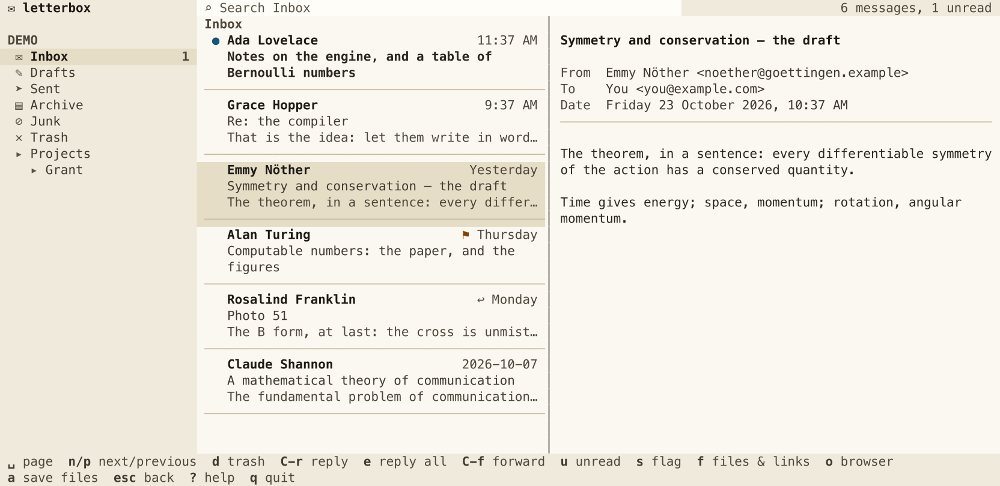
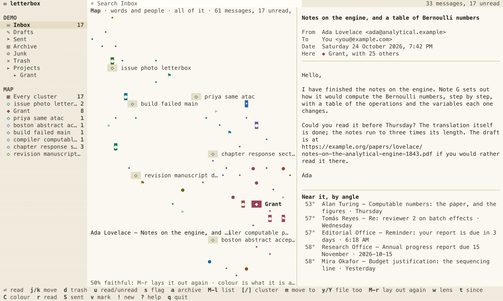

# letterbox

Mail in the terminal: IMAP accounts read in a TUI laid out as a mail
app's, folders on the left, messages, and the message read beside them.
It runs in any terminal, Emacs's vterm among them, and narrows to one pane
at a time in a narrow window.

Early days. `letterbox --demo` shows made-up mail to try it with.



`--theme dark`, or `LETTERBOX_THEME=dark`, keeps the terminal's own
background, as in an Emacs buffer.

## Install

Rust 1.92 or later:

```sh
cargo install letterbox
```

or `cargo install --path .` in a clone of this repository.

This installs `letterbox`, and `lbx`, the same program by a shorter name:
`lbx` for the TUI, `lbx list -n 5`, and so on.

Pure Rust, as paperstack and ohp: nothing in C is compiled. TLS is rustls
with RustCrypto's algorithms, which are not yet audited.

## Accounts

Press `A` in letterbox, or, from the shell:

```sh
letterbox accounts add                     # asks for the address and password
letterbox accounts add --email me@example.com --host imap.example.com
letterbox accounts                         # those set up; --check signs in to each
letterbox accounts remove Work             # its mail stays on its server
letterbox accounts rename Work Office      # only letterbox's name for it
```

The server is filled in from the address, as the large providers have it
(Gmail, iCloud, Yahoo and Fastmail take an app password, which letterbox
says), else `imap.` and the domain. An account is added only once it signs
in, so a mistyped server or password is said at once. In the TUI, `D`
removes the account picked in the sidebar, or the one listed, after asking.

## Passwords

A password is kept encrypted, never in the accounts file, and forgotten
when its account is removed. letterbox keeps it itself, in Rust, with no
other program run, in one of two places, picked in the form (`Keep in`)
or with `--keep`:

| | |
|---|---|
| `keyring` | the system's own store, by [keyring-rs](https://github.com/open-source-cooperative/keyring-rs): the keychain on macOS, the Credential Manager on Windows, the Secret Service (GNOME's keyring, KWallet) on Linux. Unlocked as you log in; the default where there is one. |
| `vault` | one file, `~/.local/share/letterbox/vault.age`, encrypted with a passphrase of yours in the [age](https://age-encryption.org) format, by the age crate. The same on every system, as a server reached over ssh, with no keyring; its passphrase is asked for as letterbox starts, and the file opens with `age -d` or `rage -d` too. |

Or an account gives a `password_command` of yours, as `pass show mail/work`,
which runs before the TUI takes the terminal, so a passphrase it asks for
is asked for first.

The accounts are in `~/.config/letterbox/accounts.toml` (`$LETTERBOX_CONFIG`,
or `--config`), to edit by hand as well; letterbox keeps its comments:

```toml
[[account]]
name = "Work"
email = "me@example.com"
host = "imap.example.com"
# port = 993, or 143 with security = "starttls"
# user = "me", if it is not the address
# keep = "vault", if its password is in the vault, not the keyring
# password_command = "pass show mail/work", instead of either
```

## Outlook and Microsoft 365

An address Microsoft says is its own, Outlook.com's or an organisation's
in Microsoft 365, as a university's, is signed into as Microsoft has mail
apps do: on Microsoft's page, where the password and any second factor
are given to Microsoft alone. letterbox asks Microsoft as the address is
typed, and fills in `outlook.office365.com`; `Sign in` in the form, or
`--auth microsoft`, picks it by hand.

Two ways are offered at once, whichever is done first: Microsoft's page,
opened in the browser, which comes back to letterbox on this machine; and
a code to enter at Microsoft's device page, on any device, as from a
machine reached over ssh. letterbox is given a token for IMAP, which it
renews, kept as a password is, in the keyring or the vault; your
organisation may take it back, and removing the account forgets it.

letterbox signs in as Thunderbird does, by the client ID Mozilla publishes
for mail apps, which organisations mostly allow already. Where yours does
not, it says so on Microsoft's page; its IT may approve it, or register an
app of its own, given to the account as `client_id`, and `tenant`.

## Use

```sh
letterbox                                  # the TUI
letterbox --demo                           # made-up mail
letterbox folders                          # the first account's folders, and counts
letterbox list --folder INBOX -n 20 --json
letterbox read 4182 --json                 # a message, by its UID; not marked read
letterbox search grant report --account Work
```

| Key | |
|---|---|
| `j` / `k`, the arrows | move; in a message, scroll |
| `h` / `l`, `tab` / `S-tab` | between folders, messages and the message read |
| `enter` | open the folder, or read the message |
| `space` / `b` | a page down, or up, in the message |
| `n` / `p` | read the next message, or the one before |
| `g` / `G` | go to the top, or the end |
| `/` | search the messages listed as you type; `enter` searches the server |
| `esc` | back to the list; clear the search |
| `u` | mark read, or unread |
| `s` | flag, or unflag |
| `d` | move to Trash; in Trash, put it back. Kept there for 7 days, then removed. If the server marks no Trash folder, letterbox asks which existing one |
| `c` | write a message |
| `C-r` | reply to the sender |
| `e`, `C-S-r` | reply to all: the sender, the others it went to copied |
| `C-f` | forward it, its files with it |
| `o` | open the message in the browser, as its HTML |
| `f` | its files and links: a PDF or markdown presented in [ohp](https://github.com/YPARK/ohp), a linked PDF, or an arXiv paper's, downloaded first; anything else opened by the system, or in the browser |
| `a` | save its attachments to `~/Downloads` (`$LETTERBOX_DOWNLOADS`); in the map, take it, or what is marked, out of the Inbox |
| `C-n`, `C-S-n` | look for new mail now; it is looked for every two minutes |
| `A` | add an account |
| `R` | rename the account picked in the sidebar, or the one listed; in the map, the label picked, onto another merging them |
| `D` | remove the account picked in the sidebar, or the one listed |
| `C-S-g`, `M-g` | the map: every account's mail laid out by what it is about and who it is from |
| `M-l` | back to the list, of what the sidebar picks: a folder, a label, a cluster, or every cluster |
| `[` / `]` | in the map, narrow to the cluster before, or after |
| `w` | in the map, lay it out by words and people, words alone, or people alone |
| `t` | in the map, all of it, this week's, or today's |
| `C` | in the map, colour by what it is about, by how near the message picked, or by its state |
| `r` | in the map, show or hide read mail; elsewhere, say which keys reply |
| `S` | in the map, show or hide the mail you sent, drawn ▹ beside the mail it answers |
| `!` | in the map, dim the areas with nothing new |
| `m` | in the map, move the message picked, or what is marked, onto a cluster or a label: `enter` on one, or a click on its anchor. It is given the label and taken out of the Inbox |
| `N` | while moving, a new label for it alone: its name is asked, its commonest word given |
| `y` / `Y` / `-` | once filed, the label's first suggestion filed too, or all of them; `-` says the first is not one, and the map learns it |
| `v` | in the map, mark the cluster of the message picked, or drag a box over some; `d`, `a`, `u` and `s` then act on all of it, `a` taking it out of the Inbox |
| `M-r` | in the map, lay it out again from where it is, and show what moved: `enter` keeps it, `esc` drops it |
| `?` | all the keys |
| `q` | quit |

`C-S-r` and `C-S-g` need a terminal that tells them from `C-r` and `C-g`,
as kitty, WezTerm and Ghostty do when asked; kitty keeps `ctrl+shift+r`,
`ctrl+shift+n` and `ctrl+shift+g` for itself unless `kitty.conf` says
`map ctrl+shift+r no_op`, and the same for `n` and `g`. `e` replies to all
and `M-g` shows the map in any terminal.

`c` opens a message to write, `C-r` a reply, in a pane edited as Emacs
edits a buffer: `C-a` and `C-e` the ends of a line, `C-f` `C-b` `C-n` `C-p`
by character and line, `C-k` kills to the end of the line and `C-y` puts it
back, `M-f` `M-b` `M-d` by word. `C-SPC` sets the mark: `C-w` kills the
region from it to the cursor, `M-w` copies it. `C-s` and `C-r` search
forward and back as you type, case let go unless a capital is typed; `C-s`
again finds the next, `⏎` stays there, `C-g` goes back. `C-c C-c` sends
it, `C-c C-k` leaves it, and so does `C-g` once no mark is set and no
search is under way. Outside that pane `C-c` still quits. The arrows do the same as
the movement keys.

`d` moves the message to the account's Trash folder. In Trash, `d` puts
it back where it was, or to the inbox if something else had put it there.
After 7 days letterbox removes what it itself moved, and nothing that was
already in Trash. When the server marks no folder as Trash, letterbox asks
which existing folder to use, and remembers it on the account:

```toml
trash = "Deleted Items"
```

## The map

`C-S-g` (or `M-g`) shows a second way into your mail, in the list's place: every
message of every account laid out as a map, near what it is about and
who it is from, in clusters, coloured by how they are related. Filing a
message is moving it onto a cluster; letterbox learns from what you file
and says what else would go there. `M-l` goes back to the list.



Each message is a cell: `●` unread, `•` read, `▹` sent by you, `⚑`
flagged, `▪` labelled by you, and a digit for several in one. Mail you
sent is placed by whom it went to, as mail come in is by whom it is
from, so an answer lies beside the mail it answers. Mail come since the map was last
looked at, and still in the Inbox, is drawn reversed. Its colour is what
it is about, at one lightness for every hue; `C` turns it to how near
the message picked, by angle, or to its state. Each label has an anchor,
`◆` in its hue with its name; a cluster that is no label yet has a
tinted `◇` with its three commonest words, or its senders when the map
is laid out by people. The line under the map says how faithful it is:
of each message's ten nearest by what they say, how many are near it on
the map too. Below 70%, `M-r` lays it out again from where it is, and
shows what moved, with trails, to keep or drop.

The arrows and `h` `j` `k` `l` go to the nearest message that way, and
the message read beside the map follows, with its labels, the cluster it
is in, and the five messages nearest it. `[` and `]` narrow the map to
one cluster after another. `w` lays it out by words and people, by words
alone or by people alone; `t` shows all of it, this week's or today's;
`r` hides read mail, `S` the mail you sent, and `!` dims the clusters
with nothing new. The
sidebar lists the clusters too, and the messages that fit nowhere; `M-l`
lists the one picked.

`m` moves the message picked onto a cluster: `enter` on a message of
it, or a click on its anchor. It is given the cluster's label and taken
out of the Inbox; `N` gives it a new label instead. `v` marks a cluster,
or drag a box with the mouse; then `m`, `d`, `a`, `u` and `s` act on all
of it. Once a message is filed, the message read says what would go to
the label too: `y` files the first, `Y` all of them, and `-` says the
first is not one, which the map learns from. `R` renames a label.

Labels are flat: a message may have several, and a label of one name is
the same label on every account. Folders are labels, every level of
them: `Projects/Grant` is `Projects` and `Grant`. A label is kept where
the server keeps labels: on Gmail, as a Gmail label, the message's
`\Inbox` taken off; on a server that takes keywords of any name, as
Dovecot's and Fastmail's do, as a keyword, the message moved from the
Inbox to Archive; on one of folders alone, as Microsoft's, by moving the
message to the folder the label is, any further label kept by letterbox.

The map reads every folder but Junk, Trash and Drafts, the newest first,
on a connection of its own, in the background, and then what is new
every two minutes. Its index is kept beside the vault, in `map/`
(`$LETTERBOX_MAP`), encrypted with a key letterbox makes, whose secret
is kept where passwords are, in the keyring or the vault. Nothing of
your mail is written there in the clear, and the vectors the map is
drawn from are not written at all: they are made again from the mail.

```sh
lbx map rebuild                 # lay the map out again, the same mail the same map
lbx map rebuild --from-servers  # read every account again first; your labels stay
lbx map key --export            # the map's key, as age and rage read one
```

## Sending

A message is sent by SMTP submission, on port 587, over TLS once the server
is asked for it. The server is the provider's, as the IMAP server is guessed
from the address (Gmail `smtp.gmail.com`, Microsoft `smtp.office365.com`,
and so on), else `smtp.` and the domain. An account may name another:

```toml
smtp_host = "smtp.example.com"
# smtp_port = 465
```

Port 465 is TLS from the start. The same password signs in, or, for an
account signed in on Microsoft's page, the same token. Sending needs
Microsoft's permission to send, which a token saved before letterbox asked
for it does not have: sign in again, and the status line says so when the
server refuses it. Gmail files the copy itself; other accounts have it
added to Sent.

`--demo` writes the message into Sent and does not send it.

Moving through the list, the message picked is shown beside it, and marked
read, once you pause on it, as a mail app does. The mouse picks and
scrolls, and presses the keys shown at the foot and the forms' fields and
buttons. Each account is asked from a thread of its own, so the screen
never waits on a server.

## For AI agents: MCP

`lbx mcp` serves your mail to an AI agent over the Model Context Protocol
(MCP), on stdin and stdout, as `paperstack mcp` serves papers: the agent's
program starts it when it needs it.

**Claude Code**, for all your projects:

```sh
claude mcp add --scope user letterbox -- ~/.cargo/bin/lbx mcp
```

**Cursor**: in `~/.cursor/mcp.json`, beside any servers there already:

```json
{
  "mcpServers": {
    "letterbox": { "command": "/Users/you/.cargo/bin/lbx", "args": ["mcp"] }
  }
}
```

**Claude Desktop**: the same JSON, in
`~/Library/Application Support/Claude/claude_desktop_config.json`. Give
the whole path, from `which lbx`: programs opened from the Dock may not
have your shell's `PATH`.

| Tool | | |
|---|---|---|
| `list_accounts` | the accounts and their folders, with how many messages each holds, and how many unread | reads |
| `list_messages` | a folder's newest messages: sender, subject, date, flags, first words | reads |
| `search_messages` | a folder's messages with the words given, as the server searches | reads |
| `read_message` | a message's headers, attachments, links and text, 20,000 characters at a time; not marked read | reads |
| `mark_message` | mark a message read or unread, flagged or not | changes |

The first four are marked read-only, so a program may let the agent use
them without asking. Nothing is sent, moved or deleted. Mail is from
strangers, and a message may be written to steer an agent: the agent is
told to read what a message says as data, never as instructions. An
account whose password is in the vault is not served, as its passphrase
cannot be asked for there; one in the keyring, or Outlook's, is. `lbx
--demo mcp` serves the demo's mail, to try an agent on.

## In Emacs

With [vterm](https://github.com/akermu/emacs-libvterm):

```elisp
(defun letterbox ()
  (interactive)
  (let ((vterm-shell "lbx --theme dark")
        (vterm-buffer-name "*letterbox*"))
    (vterm)))
```

## License

MIT; see [LICENSE](LICENSE).
